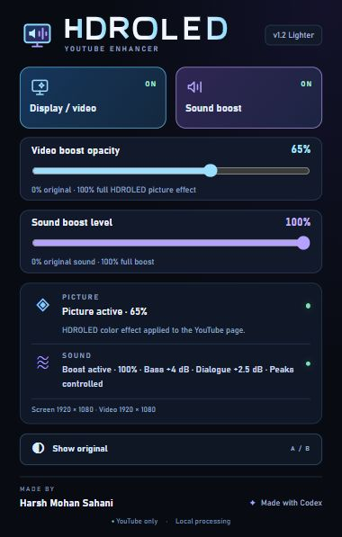
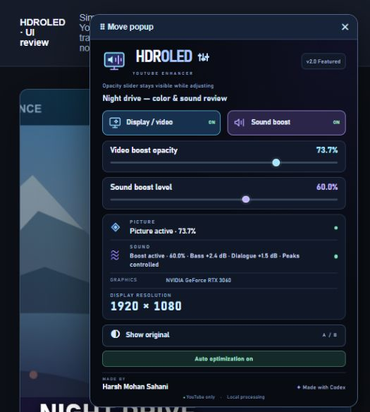

<p align="center"></p>

<p align="center"><strong>More depth in the picture. Fuller bass. Clearer dialogue.</strong><br>Created by <strong>Harsh Mohan Sahani</strong> · Made with <strong>Codex</strong></p>

<p align="center"><a href="https://github.com/harsh-mohan-99/hdroled-youtube/releases/tag/v2.0.0">Download v2.0 Featured</a> · <a href="https://github.com/harsh-mohan-99/hdroled-youtube/releases/tag/v1.2.0">Download v1.2 Lighter</a> · <a href="INSTALL.md">Installation guide</a></p>

**HDROLED** gives accessible YouTube pages a restrained color treatment and supported player audio a fuller, clearer sound. Picture and sound have independent switches and strength sliders. **Show original** compares both effects without losing your choices.

**Enjoy using HDROLED? Click ☆ Star at the top of this repository.** A star helps other viewers discover the project and lets the creator know it is useful. Downloads and every feature remain free; no star is required.

## Pick your edition

| | **v1.2 — Lighter** | **v2.0 — Featured** |
| --- | --- | --- |
| Best for | Set your preferred picture and sound levels, then watch | Adjust while watching and let each video keep its own settings |
| Controls | Compact toolbar popup, separate picture/sound switches and sliders | Typographic logo button opens movable controls over YouTube |
| Precision | Straightforward whole-percent manual adjustment | Actual 0.1% steps through controls, storage and processing |
| Automatic adjustment | No playback sampling or automatic level changes | Conservative hardware-hint starting level, sustained-slowdown response and gradual quality recovery |
| Page choices | One set of preferences across YouTube tabs in the browser profile | Independent settings for each tab/video, with protection against late edits during navigation |
| Viewing while adjusting | Toolbar controls | Picture slider stays visible while the other popup surfaces fade |
| Comparison | Show original for picture and sound | Show original for picture and sound; manual choices take priority over auto |
| Background work | Smaller manual implementation, without a performance sampler | More functionality and a visibility-aware sampler during usable playback |

**Choose Lighter if you value simplicity.** It does the core picture-and-sound job with fewer moving parts: set two levels, enable the effects you want, and use Original to compare. It avoids the extra monitoring and page-state machinery of Featured. That makes it the simpler edition, not a promise of a particular CPU saving or identical performance on every PC.

**Choose Featured if you want more control and convenience.** Its movable page popup makes live adjustment easier, the current title follows the video, and settings remain separate when switching tabs or videos. Fractional adjustment makes small changes possible. Automatic changes preserve an enabled picture effect, pause after manual edits, and recover toward the initial quality target after sustained healthy playback. No preset picker is required.

## Download

| Edition | Chrome / Edge / Brave / Opera / Vivaldi | Firefox |
| --- | --- | --- |
| **v2.0 Featured** | [Download Chromium ZIP](https://github.com/harsh-mohan-99/hdroled-youtube/releases/download/v2.0.0/HDROLED-2.0-Featured-Chromium.zip) | [Download Firefox ZIP](https://github.com/harsh-mohan-99/hdroled-youtube/releases/download/v2.0.0/HDROLED-2.0-Featured-Firefox.zip) |
| **v1.2 Lighter** | [Download Chromium ZIP](https://github.com/harsh-mohan-99/hdroled-youtube/releases/download/v1.2.0/HDROLED-1.2-Lighter-Chromium.zip) | [Download Firefox ZIP](https://github.com/harsh-mohan-99/hdroled-youtube/releases/download/v1.2.0/HDROLED-1.2-Lighter-Firefox.zip) |

Both editions are available independently. Install **one HDROLED edition at a time** to avoid overlapping filters/audio graphs. [All releases](https://github.com/harsh-mohan-99/hdroled-youtube/releases) include the original v1.0 for historical reference. [Repository download mirrors](downloads/) provide the same browser packages and SHA-256 checksums.

These are downloadable source/unpacked browser extensions. Firefox packages are unsigned: temporary installation is supported; permanent installation needs Mozilla signing. Sharing this repository does not mean the extension is listed in a browser store.

## Install in a minute

1. Download your edition and browser ZIP, extract it, and disable older HDROLED copies.
2. Chromium browsers: open the extensions page → Developer mode → **Load unpacked** → select the extracted folder containing `manifest.json`.
3. Firefox: open `about:debugging#/runtime/this-firefox` → **Load Temporary Add-on** → choose the Firefox ZIP or its extracted manifest.
4. Refresh existing YouTube tabs. Start playback and open the extension from the browser toolbar.
5. Featured: click the **HDROLED logo** for movable page controls. Lighter: use the ordinary toolbar popup. Enable/adjust picture and sound independently.
6. Click the playing video once if the sound status requests activation. Use **Show original** to compare.

See [INSTALL.md](INSTALL.md) for updating, switching editions, troubleshooting and removal.

## What changes—and what stays local

- **Picture:** one page color-filter pass, scaling contrast, saturation and brightness according to your chosen strength. No dark blue overlay or stacked filter passes.
- **Sound:** adjustable bass lift, dialogue-presence EQ, compression, make-up gain and peak control on supported YouTube media. Dialogue enhancement is EQ, not voice isolation. Perceived loudness depends on the source and player volume.
- **Original:** temporarily bypasses HDROLED picture/audio processing and retains your levels.
- **Scope:** accessible HTTPS YouTube pages only. No power-management, battery-policy, system-theme, monitor-calibration, OS-volume or driver changes. No microphone, recordings, analytics or uploads.

HDROLED is an **SDR appearance effect**. It cannot turn a normal panel into physical OLED hardware or create genuine HDR output. Browser processing still consumes CPU/GPU resources.

## How Featured's automatic adjustment works

Coarse logical-processor and optional browser memory hints select a starting video level on a smooth 55–80% scale; unavailable hints use 67.5%. This is a heuristic, not a PC benchmark. Sound starts at 60.0% and remains manual.

During visible, usable playback, a sample roughly every two seconds checks dropped-frame deltas and responsiveness. Warmup and sustained evidence avoid reacting to every brief spike. The measured severity selects a small proportional reduction, stored to 0.1%, with a 20.0% floor. The picture effect stays enabled. After sustained healthy playback, quality gradually recovers toward its starting target.

Manual edits pause automatic adjustment; the **Auto optimization on/off** button explicitly resumes or disables it. Original comparison also pauses changes. Tiny messages appear on the YouTube page at startup or adjustment, not inside the controls.

**Displayed percentages are effect strength, not a measured speed improvement.** Lower strength does not necessarily reduce the cost of the color-filter pass. Other applications, network buffering and browser behavior can affect playback. Featured does not read system-wide CPU/GPU load, and there is no 50% CPU gate.

Featured shows a clean GPU name when exposed by the browser and hides unavailable hardware rows. Ordinary extensions cannot read Windows sound-driver names. Display resolution is browser-reported CSS-pixel screen size and may differ from physical pixels under OS scaling.

## Interface and picture references

| v1.2 Lighter | v2.0 Featured |
| --- | --- |
|  |  |

These are actual interface renders with **simulated playback/hardware**, not live YouTube enhancement evidence. The example GPU name is a demo value. [See the opacity slider remaining visible during adjustment](docs/visuals/visible-slider-review.jpg).

| Original reference illustration | Same illustration with the picture filter |
| --- | --- |
|  |  |

The before/after pair is self-authored reference artwork, not a live video capture. It demonstrates the configured color operations only; screenshots cannot demonstrate audio quality.

## Compatibility and common fixes

Desktop Chrome, Edge, Brave, Opera, Vivaldi and Firefox 140+ are compatibility targets. Safari/Apple and mobile browsers are excluded. Installation and viewing/listening have not been verified on every target browser. DRM, CORS, autoplay restrictions and native Picture-in-Picture/fullscreen may limit processing or hide page controls.

- **After installation/update:** reload the extension and refresh old YouTube tabs so they load the new code.
- **Popup does not open:** check enabled/pinned status, pause playback and retry, then refresh YouTube. Featured no longer blocks opening behind a pending save or disables the toolbar during reconnection.
- **Sound unchanged:** click the playing video once and read the sound status. Unsupported/protected audio stays unchanged.
- **Overlapping effects:** disable other HDROLED copies before switching editions. Refresh affected tabs.
- **Report an issue:** include edition/version, browser, reproduction steps and whether Original changes the result. Never include private account data or credentials.

## Source, validation and contributions

The default branch contains Featured. [Lighter source](https://github.com/harsh-mohan-99/hdroled-youtube/tree/release/lighter-v1.2) is preserved separately. Each tagged release provides its matching source archive.

```sh
npm test
python scripts/package.py
```

Runtime has no external package dependencies. Node.js 22.15+ runs tests; Python 3 packages browser ZIPs. **Featured: 41 checks. Lighter: 20 checks.** Tests cover browser/media boundaries with stand-ins; live cross-browser viewing/listening remains a separate check. GitHub Actions checks use read-only repository permissions. A release publisher can use a temporary contents-write job token to publish verified ZIPs.

Ideas, focused bug reports and tested improvements are welcome. Read [CONTRIBUTING.md](CONTRIBUTING.md), [PRIVACY.md](PRIVACY.md) and [SECURITY.md](SECURITY.md). If HDROLED helps your viewing, **give the repository a star** and share its link with others.

Created by **Harsh Mohan Sahani**, made with **Codex**. [MIT License](LICENSE). Independent of YouTube and Google.
