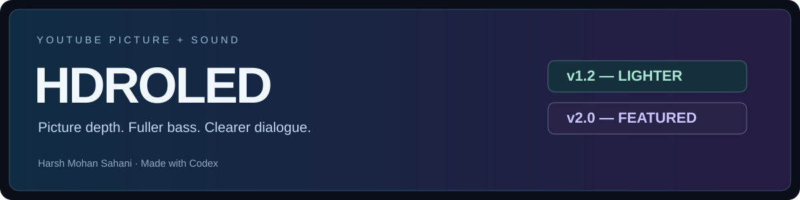
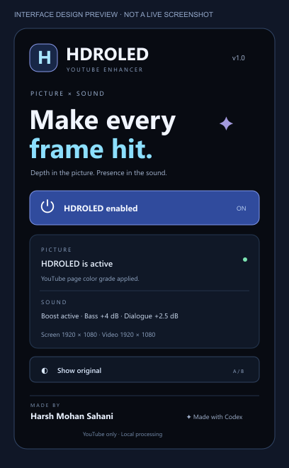
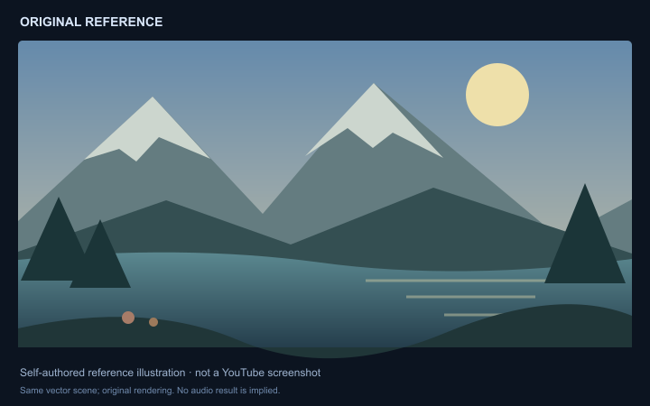
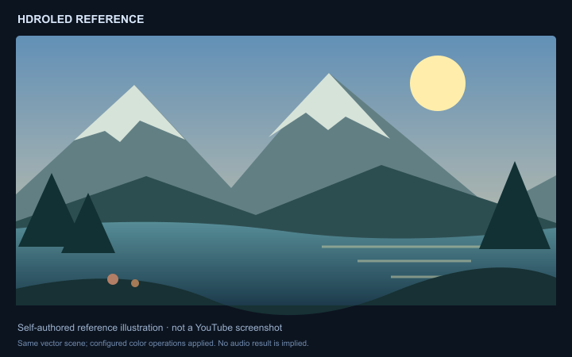

<p align="center"></p>

<p align="center"><strong>YouTube picture depth. Fuller bass. Clearer dialogue.</strong><br>Made by <strong>Harsh Mohan Sahani</strong> · Made with <strong>Codex</strong></p>

<p align="center">Version 1.0 · Manifest V3 · YouTube only · Browser-local processing · MIT</p>

**HDROLED** adds a restrained picture treatment and a fixed movie-oriented audio chain to the currently accessible YouTube page. Its animated dark popup has two controls: **Enable HDROLED** and **Show original**. No presets or sliders.

> **Scope:** This extension does not change power management, Windows/macOS/Linux settings, monitor calibration, HDR mode, system volume or audio drivers. It only adjusts the current accessible YouTube page's rendered colors and supported player audio inside the browser. It is an SDR appearance effect, not a way to create physical OLED blacks or genuine HDR.

## Quick start

1. Download a browser ZIP from [Releases](https://github.com/harsh-mohan-99/hdroled-youtube/releases), or use **Code → Download ZIP** for the source, then extract it.
2. Disable older HDROLED/Luma builds and refresh existing YouTube tabs.
3. Open your browser's extensions page, turn on Developer mode, and choose **Load unpacked**.
4. Select this repository's **`extension`** folder—the folder containing `manifest.json`.
5. Refresh YouTube, play a video, open HDROLED and enable it. If sound status requests it, click the video once and reopen the popup.
6. Use **Show original** to compare picture and sound together. This preference applies across YouTube tabs in this browser profile.

See the [step-by-step installation tutorial](INSTALL.md) for supported browsers, Firefox, updating and removal.

## What it does

| Area | Behavior |
| --- | --- |
| Picture | Contrast 1.08, saturation 1.10 and brightness 1.025, applied once to the YouTube page; fullscreen transfers the filter to the fullscreen container. |
| Bass | A +4 dB low shelf around 105 Hz, with a 35 Hz rumble cut. |
| Dialogue | A +2.5 dB presence lift near 2.2 kHz and a small 280 Hz cut to reduce muddiness. This is EQ, not voice isolation. |
| Sound boost | 1.6× configured make-up gain after gentler compression, followed by soft peak control. Actual perceived loudness depends on the source and player volume; loud scenes can be compressed. |
| Original | Bypasses the extension's complete picture/audio processing. The original page filter value and priority are restored. |
| Interface | Bold dark colors, subtle orbit/float/pulse effects and reduced-motion support. Shows processing state plus browser-reported screen/source resolution. |

No microphone access, recording, analytics, uploads, battery monitoring, OS commands, background services or remote libraries are included. Normal rendering/audio processing still uses computer resources; “no power-management changes” does **not** mean zero CPU/GPU use.

## Visual review

<p align="center"></p>

| Original reference | HDROLED reference |
| --- | --- |
|  |  |

**These are clearly labeled, self-authored visual references—not live YouTube screenshots.** The same vector scene is rendered before and after the configured color operations. The UI image is a design preview. Live capture timed out and the headless browser was blocked in this environment. Do not present these as real gameplay/video results or audio evidence. [Capture instructions and outstanding screenshot work](docs/screenshots/README.md) explain how to replace them with a same-frame YouTube A/B pair before publication.

## Browser support

- **Desktop Chrome, Edge, Brave, Opera and Vivaldi:** use `extension/` or the packaged Chromium ZIP. These are compatibility targets; installation/rendering has not been verified on every browser.
- **Firefox 140+:** use the generated Firefox ZIP. Temporary testing is supported through `about:debugging`; permanent distribution requires Mozilla signing.
- **Safari/Apple:** excluded from this project. Mobile browsers are not tested.

The extension runs only on `www.youtube.com` and `m.youtube.com`. It does not run on other websites or browser-internal pages. Native Picture-in-Picture, DRM, closed/custom players and sources blocked by CORS can remain unprocessed.

## Privacy and permissions

Only the **`storage`** API permission is requested. Static content-script matches limit page access to YouTube. The popup reads only the active tab ID and messages its existing content script. It does not request all-sites, microphone, tab-capture, browser-history, scripting or system permissions.

Two local booleans store enabled/original preferences. Resolution and processing counts are displayed temporarily. Media samples stay in the browser's audio graph and are not recorded or transmitted. Read [PRIVACY.md](PRIVACY.md).

## Development

Requirements: Node.js 22.15+ for checks; Python 3 for ZIP packaging. Runtime extension code has no package dependencies.

```sh
npm test
python scripts/package.py
```

The packager generates Chromium and Firefox ZIPs under `dist/`, with `manifest.json` at each archive root. Load the actual extension ZIPs or source folder; the repository ZIP itself is not a store package.

A read-only [GitHub Actions workflow](https://github.com/harsh-mohan-99/hdroled-youtube/actions) runs tests and verifies both browser packages on pushes and pull requests. The initial published source passed these checks.

```text
extension/          Browser runtime and dark popup
manifests/          Firefox manifest variant
tests/              Node tests with browser/DOM/audio boundary stand-ins
scripts/            Local ZIP packaging
docs/visuals/       Clearly labeled review imagery and source SVGs
docs/screenshots/   Real screenshot capture checklist
```

## Known limits and troubleshooting

- **No connection:** open YouTube and refresh the tab after installation/update. Disable previous builds so their injected styles/audio graphs do not compete.
- **Popup will not open:** pause the video and click the extension again. Check the Extensions menu/pin and enabled state, then refresh YouTube and retry. This is troubleshooting, not a guaranteed browser-popup repair.
- **New YouTube page:** if HDROLED does not reconnect after navigation, refresh that new page once, start playback and reopen the extension. Do this on each new page where the problem occurs; no automatic page-reload loop is installed.
- **Sound unchanged:** click the playing video once. If browser autoplay, CORS, DRM or another sound extension prevents processing, status reports unchanged rather than a guaranteed boost.
- **Audio interruptions:** once Web Audio connects to an element, routing persists until page refresh. Refresh after a version update, incompatible source change or audio-device interruption.
- **A/B scope:** Show original bypasses this extension only. Existing OS, GPU or monitor profiles are separate and remain untouched.
- **Page layout:** a root filter affects compositing. Some positioned or top-layer UI can render differently; compare with Original if that happens.
- **Evidence:** tests exercise logic and mocked browser/audio boundaries. Live visual and listening verification remains outstanding. Static images cannot demonstrate audio quality.

## Version 1.0 validation status

This is the initial **HDROLED 1.0 source build**. Local tests cover settings, YouTube-only access, picture restoration, audio graph configuration/routing and popup comparison. Live cross-browser visual/listening verification and real same-frame screenshots remain outstanding. The included visual examples are labeled reference illustrations, not video captures. Extension-store signing/review is separate from sharing this source repository.

For future versions, the most useful improvements are measured audio A/B tests, real same-frame video captures, and broader playback tests across normal videos, Shorts, ads, seeking and fullscreen. Keep the two-button interface and YouTube-only permissions.

## Credits and license

Created by **Harsh Mohan Sahani**, made with **Codex**. Code and self-authored review illustrations are provided under the [MIT License](LICENSE). YouTube is a trademark of its respective owner; this project is independent and is not endorsed by YouTube or Google.
